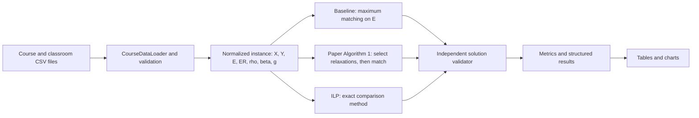

# Design and Initial Version

This document covers the design stage of the project **Facilitating Matches on Allocation Platforms**. It is separate from the topic proposal in `PROPOSAL.md`. The Baseline and a project-adapted version of paper Algorithm 1 (SNH-SB) are implemented; the ILP is planned next.

## 1. Model

We use the paper's **one-to-one allocation** setting: each request is an agent, each available room (or room–time-slot pair) is a resource, and each resource can be assigned to at most one agent.

- \(X\): agents (course requests).
- \(Y\): resources (classrooms; use classroom–time-slot pairs when time slots matter).
- \(E \subseteq X \times Y\): compatible agent–resource pairs that need no relaxation.
- \(E_R \subseteq (X \times Y)\setminus E\): relaxable incompatible pairs. Each pair \(e\in E_R\) has a finite discomfort cost \(\rho(e)\). Totally incompatible pairs have infinite cost and are not included in \(E_R\).
- \(\hat E \subseteq E_R\): relaxation suggestions selected by the facilitator.
- \(\beta\): maximum permitted aggregate relaxation cost.
- \(g\): the aggregation function, either **size**, \(g(\hat E)=|\hat E|\), or **total discomfort**, \(g(\hat E)=\sum_{e\in\hat E}\rho(e)\). The budget is interpreted in the corresponding units.

An allocation is a matching \(M\subseteq E\cup\hat E\). The objective is to maximize its cardinality, subject to \(g(\hat E)\leq\beta\) and the participation guarantee selected for the experiment. In keeping with the paper's Algorithm 1, the planned guarantee is **strong no harm and strong benefit to relaxers (SNH-SB)**.

For a graph \(H\), let \(\mu(H)\) be the size of a maximum matching and \(\Gamma(H)\) the agents that appear in every maximum matching of \(H\). Let \(X(F)\) denote the agents incident to at least one pair in \(F\). SNH-SB requires, for every subset \(F\subseteq\hat E\):

\[
\Gamma(E)\subseteq\Gamma(E\cup F)
\quad\text{and}\quad
X(F)\subseteq\Gamma(E\cup F).
\]

Thus, agents guaranteed an assignment before the advice remain guaranteed one, and any agent asked to relax a restriction remains guaranteed one even if only some recommendations are followed. This is stronger than checking that one particular maximum matching contains those agents.

**Data mapping assumption:** each course-table row represents one scheduled meeting and is a separate assignment request. Multiple meetings of a group have distinct meeting IDs and may be assigned to different rooms, matching the source data when its meetings list different rooms. A room–exact-time-slot pair is a resource; requests in the same period, weekday, and identical start/end range compete for it. This initial model does not treat partially overlapping but non-identical time ranges as conflicts.

The course `planned_registered_students` field determines the capacity preference range from the paper's course-data preprocessing: minimum \(10\lfloor n/10\rfloor\), maximum \(\min(10\lfloor(4n/3)/10\rfloor,270)\). Room capacities are compared in 10-seat tiers. Each tier below the minimum or above the maximum contributes one capacity discomfort unit; rooms in the range create compatible edges. This project assumes that assigning more students than a room's listed capacity is permitted with a penalty, so undersized rooms are represented as relaxable edges. The current cost bands are a scoring assumption and should be replaced if the institution defines a specific penalty scale. This project models only capacity, not the paper's region or accessibility preferences. Baseline uses only compatible edges.

## 2. Components and Data Flow

| Component | Responsibility |
|---|---|
| `CourseDataLoader` and input validation | Read course meetings and classrooms, construct exact room/time-slot resources, and report malformed input explicitly. |
| `AllocationInstance` | Provide a single validated representation of agents, resources, and compatible/relaxable edges. |
| `BaselineMatcher` | Compute a maximum-cardinality matching using only \(E\); it does not recommend relaxations. |
| `Algorithm1Matcher` | Select relaxable edges with the paper's SNH-SB weighted matching and dummy-agent procedure, then compute a maximum-cardinality allocation. |
| ILP | Find an allocation/relaxation solution for the same objective and constraints, to serve as an exact comparison on small instances. |
| `MatchingValidator` | Check matching feasibility and edge eligibility without trusting the solver's reported status. |
| Experiment runners | Coordinate algorithm execution, validation, and result reporting. |

### Comparison-method specifications

The **baseline** is an unweighted maximum-cardinality bipartite matching on \(E\). It provides the reference assignment count and neither reads nor optimizes relaxation costs; those costs are reserved for Algorithm 1 and the ILP.

The implemented **Algorithm 1** selects a recommendation set from relaxable edges with an SNH-SB weighted matching and dummy agents, then runs an ordinary maximum-cardinality matching on the original edges plus the recommendations. It accepts a size budget (number of recommendations) or a total-discomfort budget. Size is the default; total discomfort uses the current project-specific cost values, which are provisional until an institutional penalty scale is available.

The **ILP** will use binary assignment variables \(x_{xy}\) and relaxation variables \(z_{xy}\) for candidate pairs. Each agent and resource may appear in at most one assignment; an assignment may use an original edge or a selected relaxable edge; and the selected relaxations must obey the configured budget. The objective maximizes \(\sum x_{xy}\). These constraints alone do **not** enforce SNH-SB: the implementation must encode or independently enforce the guarantee for every relevant subset of recommendations. On tiny test instances, exhaustive subset checking is a practical correctness oracle. If the full guarantee is not represented in the ILP, its result must be labeled as a relaxed upper bound, not as a directly comparable solution.

## 3. Small Hand-Checked Example

Let \(X=\{c_1,c_2,c_3\}\) and \(Y=\{r_1,r_2,r_3\}\). The original compatible edges are
\[
E=\{(c_1,r_1),(c_2,r_1),(c_2,r_2)\}.
\]
All other pairs are totally incompatible except \((c_3,r_3)\), which is relaxable at discomfort cost \(1\). With size budget \(\beta=1\):

- The baseline can assign \(c_1\) to \(r_1\) and \(c_2\) to \(r_2\), for a maximum of 2 assignments; \(c_3\) is unassigned.
- Suggesting \(\hat E=\{(c_3,r_3)\}\) permits 3 assignments. The resulting maximum matching assigns each course to its corresponding room.
- The recommendation is within budget. The original maximum-matching participants \(c_1,c_2\) remain assigned, and the relaxing agent \(c_3\) is assigned. Both SNH-SB conditions hold for the two possible subsets, \(\varnothing\) and \(\hat E\).

This example will be used as a small deterministic regression test for matching, budget handling, and guarantee validation.

## 4. Correctness Checks and Next Implementation

Tests cover Baseline maximum-cardinality behavior, CSV loading, Algorithm 1 cost-aware recommendation selection, both budget modes, and SNH-SB. The SNH-SB test enumerates every two-agent/three-resource graph whose pairs are compatible, relaxable, or absent, then checks every subset of recommendations. The Baseline matcher was also checked against exhaustive search on all 689 bipartite graphs with up to three agents and three resources.

The object-oriented implementation uses `AllocationInstance`, `CourseMeeting`, `Classroom`, `CourseDataLoader`, `BaselineMatcher`, `Algorithm1Matcher`, `MatchingValidator`, and experiment runners. The next step is to implement the ILP over this shared instance representation.

## 5. Findings from the Authors' Code Repository

The authors' [code repository](https://github.com/yohayt/Facilitating-Matches-on-Allocation-Platforms) is included in `third_party/facilitating-matches-paper/` as a Git submodule pinned to commit `7457b972c7d4b04b724abe916266b997a659be3d`. Its MIT license and upstream history remain intact. The repository is primarily an experimental pipeline, not a standalone implementation library. Its [README](https://github.com/yohayt/Facilitating-Matches-on-Allocation-Platforms/blob/main/README) directs users to run figure-specific scripts. The main code paths are `preprocess/preprocess_data.py`, the dataset loaders under `preprocess/`, [util.py](https://github.com/yohayt/Facilitating-Matches-on-Allocation-Platforms/blob/main/util.py), and the `FIG3.py`–`FIG5_RIGHT.py` experiment scripts.

### What transfers to this project

1. **Separate feasible and relaxable pairs.** The preprocessing pipeline first constructs the original compatibility graph from agent preferences and resource attributes, then adds candidate edges only when the corresponding preference relaxation permits them. A candidate edge also stores its discomfort cost.
2. **Costs come from preference changes.** In the course loader, requests and rooms have multiple attributes (capacity range, region, accessibility equipment). The utility code scores each attribute value and calculates the relaxation discomfort as the sum of positive score losses from the original preference. Our project needs its own documented mapping from course/room data to \(E\), \(E_R\), and \(\rho\); the paper's repository does not define that mapping for our data.
3. **The bound has units.** The paper considers either a bound on the number of proposed relaxations or a bound on the sum of their discomforts. In the repository's experiment scripts, `budge` controls how far preference thresholds can be relaxed, while a separate `threshold` argument limits how many matched pairs use relaxed edges. The project adapter exposes a single explicit budget mode so these units are not conflated.
4. **Matching is weighted only to choose advice.** For the paper's SNH-SB Algorithm 1, each original edge receives weight \((|X|+1)^2\); a relaxable edge \(e\) receives weight \(|X|+1-u(e)/\max_{e'\in E_R}u(e')\). Added dummy agents/resources encode the candidate relaxation bound. The selected advice consists of the relaxable edges in the computed weighted matching after dummy edges and original edges are removed. The allocation platform then runs a cardinality maximum matching on the expanded compatibility graph without those facilitator weights.
5. **The paper supports two aggregation modes.** For size, the relaxation penalty term uses \(u(e)=1\); for total discomfort, it uses \(u(e)=\rho(e)\). The adapter implements these weighting modes. A zero maximum discomfort is handled explicitly.
6. **Different guarantees use different algorithms/weights.** The repository has separate graph setups and paths for SNH-SB, SNH-WB, and WNH-WB. We will initially implement only SNH-SB, matching the design above; other guarantees should not be inferred from that implementation.

### Repository limitations for reuse

- The repository does not contain an ILP implementation. The ILP is our independent comparison method.
- Its data loaders are tailored to the included datasets and introduce random choices during preprocessing (for example, room sampling and preference generation). They are not a deterministic loader for our project.
- It includes several preference-relaxation and allocation variants beyond our initial one-to-one course/room model. We should reuse the mathematical behavior and test ideas, not import the entire experimental pipeline.
- Its helper for identifying agents in every maximum matching removes an agent and recomputes matching, which is a useful small-instance oracle. Its partial-compliance experiment samples subsets; that experiment is not a substitute for checking every relevant subset when validating SNH-SB on small tests.
- Dependencies named in the repository README include NetworkX, pandas, seaborn, and matplotlib. We should add only dependencies actually needed by our implementation and experiments.

### Project adaptation of SNH-SB

The input model already contains compatible edges \(E\) and relaxable pairs \(E_R\) with costs \(\rho\). The adapter in `src/algorithms/algorithm1.py`:

1. Sets \(u(e)=1\) in size mode or \(u(e)=\rho(e)\) in discomfort mode.
2. Gives original edges weight \((|X|+1)^2\) and relaxable edges weight \(|X|+1-u(e)/\max_{e'\in E_R}u(e')\), with explicit handling for an empty/zero-cost candidate set.
3. Iteratively adds dummy agents connected to every resource, as in the repository's bounded-relaxation routine, until the advice extracted from a maximum-weight matching satisfies the selected budget.
4. Computes the final allocation using ordinary maximum-cardinality bipartite matching over \(E\cup\hat E\).

The matching weights select advice; they are not utility values for the final room assignment. The upstream `relax_all` and `relax_with_bound` helpers operate on its own multidimensional preference dictionaries and cannot consume our per-pair edge costs directly, so this is a project-specific adapter of their SNH-SB weighted-matching/dummy-agent procedure, using the repository's NetworkX dependency rather than importing those helpers. Its guarantee is checked exhaustively for every two-agent/three-resource graph and all recommendation subsets. The 10-seat capacity costs remain provisional; the default budget is by recommendation count and does not rely on that uncalibrated scoring scale.

## Sources

- Trabelsi, Y., Adiga, A., Aumann, Y., Kraus, S., & Ravi, S. S. *Facilitating Matches on Allocation Platforms*. arXiv:2508.18325, 2025. [Paper](https://arxiv.org/abs/2508.18325).
- Authors' [source repository](https://github.com/yohayt/Facilitating-Matches-on-Allocation-Platforms), especially [`util.py`](https://github.com/yohayt/Facilitating-Matches-on-Allocation-Platforms/blob/main/util.py), [`preprocess_data.py`](https://github.com/yohayt/Facilitating-Matches-on-Allocation-Platforms/blob/main/preprocess/preprocess_data.py), and [`prepare_data_courses.py`](https://github.com/yohayt/Facilitating-Matches-on-Allocation-Platforms/blob/main/preprocess/prepare_data_courses.py).
- The pinned upstream copy and its MIT license are in [`third_party/facilitating-matches-paper/`](third_party/facilitating-matches-paper/).

Trabelsi, Y., Adiga, A., Aumann, Y., Kraus, S., & Ravi, S. S. *Facilitating Matches on Allocation Platforms*. arXiv:2508.18325, 2025. [Paper](https://arxiv.org/abs/2508.18325).
